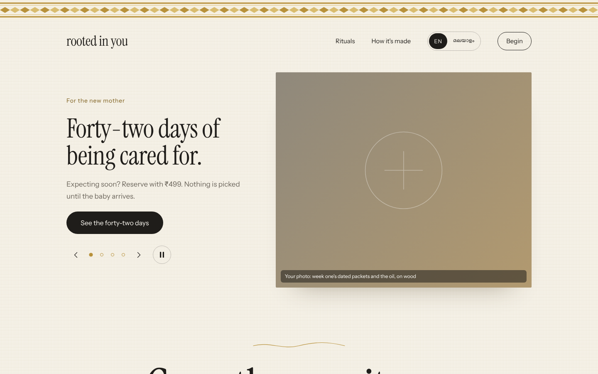
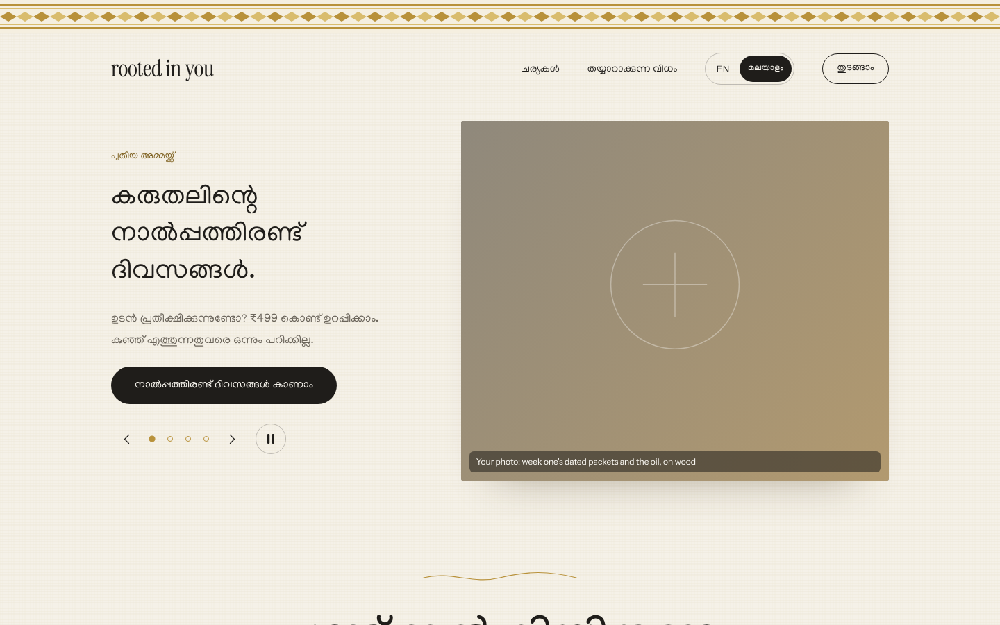
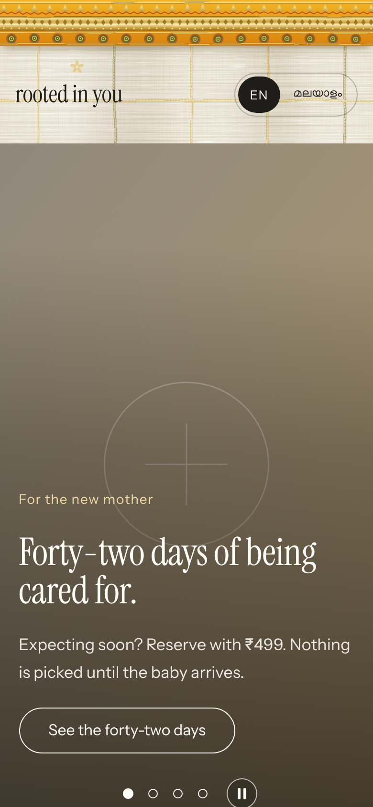

# Ayush Care — "Rooted in You"

Kerala wellness rituals storefront. React frontend, Go backend, in separate folders.



| Malayalam mode | Mobile |
| --- | --- |
|  |  |

[Full page screenshot](docs/home-full.png)

**Live demo:** https://fourandhalf.github.io/ayush-care/

## Repo layout

```
frontend/   React + Vite app (the website)
backend/    Go HTTP API (net/http, no dependencies)
docs/       Screenshots used in this README
.github/    GitHub Pages deploy workflow
```

## Run locally

```bash
cd backend && go run .                      # http://localhost:8080
```

```bash
cd frontend && npm install && npm run dev   # http://localhost:5173 (proxies /api to the backend)
```

Backend env: `PORT` (default 8080), `CORS_ORIGIN` (default `http://localhost:5173`).

## Questions section, backend and AI-crawler support

The "Questions, answered." section is the last block of the home page (anchor `#questions`, just above the footer bar). It is backed by the Go API, which stores questions and answers. The old `/faq/` address redirects to it.

**Data flow**
- Answered questions live in `backend/data/faqs.seed.json` (`status: published`). The same file lists questions that still **need an answer** (`status: pending`) so you have a to-do list.
- At runtime the backend keeps its own copy in `backend/data/store.json` (git-ignored, created from the seed on first start).
- Visitors submit questions from the section; they are saved as `pending` and are never shown publicly until you answer them.

**API** (`backend/`)

| Method | Path | Notes |
| --- | --- | --- |
| GET | `/api/faqs` | published Q&A + categories (public) |
| GET | `/api/faqs/{id}` | one published Q&A |
| POST | `/api/questions` | `{question, name?, email?}`. 10-500 chars, honeypot, 5 per hour per IP |
| GET | `/api/admin/questions?status=pending` | needs `Authorization: Bearer $ADMIN_TOKEN` |
| PUT | `/api/admin/faqs/{id}` | `{answer, question?, category?}`: answers a pending question and publishes it |
| POST | `/api/admin/faqs` | `{category, question, answer}`: add an answered Q&A |
| DELETE | `/api/admin/faqs/{id}` | remove |

The admin API is off unless `ADMIN_TOKEN` is set. Example:

```bash
curl -s -H "Authorization: Bearer $ADMIN_TOKEN" "localhost:8080/api/admin/questions?status=pending"
curl -s -X PUT -H "Authorization: Bearer $ADMIN_TOKEN" -d '{"answer":"Yes, we ship worldwide."}' localhost:8080/api/admin/faqs/q-shipping-outside-india
```

Backend env: `PORT`, `CORS_ORIGIN`, `ADMIN_TOKEN`, `DATA_FILE` (default `data/store.json`).
Frontend env: `VITE_API_URL` (where the API lives; empty = same origin / dev proxy). If the API is unreachable the page shows the bundled answers and the ask form reports that it could not reach the server.

**For crawlers (search engines and AI bots)** - `npm run build` also pre-renders the home page (questions included) to real HTML, so bots that do not run JavaScript still read the content. It writes:
- `index.html` with `FAQPage` JSON-LD, canonical and Open Graph tags, and a `faq/index.html` redirect to `/#questions`
- `robots.txt` (explicitly allows GPTBot, ClaudeBot, PerplexityBot, Google-Extended, CCBot and others) and `sitemap.xml`
- `llms.txt` (site summary and every Q&A in Markdown) and `faq.json` (machine-readable)

The published answers are baked in at build time from the seed file. After answering questions via the admin API, copy them into `faqs.seed.json` and redeploy to update the static pages and `llms.txt`.

## How the frontend was made

The page was implemented from a design mock (an HTML prototype) and ported to React.

- **Stack:** React 19 + Vite, plain CSS (`frontend/src/styles.css`), no UI library.
- **Structure:** `src/App.jsx` holds the page sections (header, hero, statement, testimonials, vaidyar, footer). `src/components/Carousel.jsx` is the banner and `src/components/Rituals.jsx` the product cards. `src/components/bits.jsx` has shared pieces (stars, photo frame, icons).
- **Bilingual copy:** `src/lang.jsx` provides a language context and a `<T en="…" ml="…" />` component. The EN / മലയാളം toggle swaps every string and sets `<html lang>`.
- **Design tokens:** colours, type (Instrument Serif / Instrument Sans / Manjari), spacing and the kasavu border are CSS variables and rules taken from the mock.
- **Interactions:** the banner auto-advances every 8 s, pauses on hover/focus or via the pause button, and has arrows and dots. The "new mother" card has kit chips that change the price. The accordions use native `<details>`.
- **Accessibility:** radio-group roles on the language and kit toggles, labelled carousel controls, visible focus rings, and `prefers-reduced-motion` support.
- **Placeholder assets:** all photos are generated gradient SVGs in `frontend/public/placeholders/` (`p1.svg` … `p10.svg`); the kasavu border and linen background are SVG tiles too. To use real photos, replace those files or change the `n` prop on `<Photo>`. Captions starting with "Your photo:" are art-direction notes from the mock; delete them when real photos go in.
- **Backend link:** the Vite dev server proxies `/api/*` to the Go server. The page does not call the API yet.

## Publishing the frontend

`.github/workflows/pages.yml` builds `frontend/` and deploys it to GitHub Pages on every push to `main`. One-time setup:

1. Merge this branch into `main`.
2. In the repo, go to **Settings → Pages** and set **Source** to **GitHub Actions**.
3. The workflow builds with `VITE_BASE=/<repo-name>/`, so assets resolve under the Pages sub-path. The site appears at the URL shown in the workflow run.

To build by hand: `cd frontend && VITE_BASE=/ayush-care/ npm run build`.
